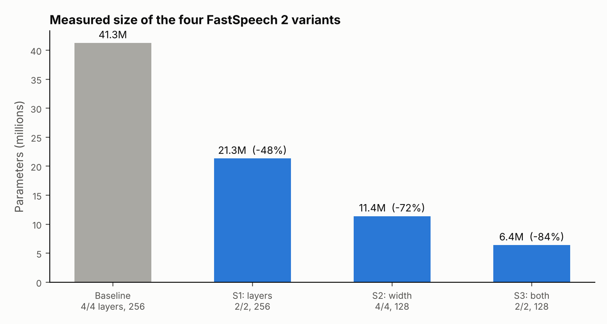

# LightTTS: compressing FastSpeech 2

Research scaffold for a deep-learning course (DATA 255, SJSU, Spring 2025 per the notebook header): which manual compression strategy gives the best speed, quality and size trade-off for FastSpeech 2 on LJSpeech-1.1: **fewer layers, a narrower hidden dimension, or both**?

> **Status: scaffold, no TTS quality results yet.** The model and evaluation code run, and the model sizes below are measured. The training run in the notebook used placeholder phonemes (no real text alignment), so I do not report MCD, RTF or MOS here.



| Variant | Strategy | Encoder/decoder layers | Hidden dim | Parameters | fp32 size | vs baseline |
|---|---|---|---|---|---|---|
| Baseline | none | 4 / 4 | 256 | 41.3M | 165 MB | n/a |
| S1 | layer reduction | 2 / 2 | 256 | 21.3M | 85 MB | -48% |
| S2 | dimension reduction | 4 / 4 | 128 | 11.4M | 46 MB | -72% |
| S3 | combined | 2 / 2 | 128 | 6.4M | 26 MB | -84% |

These counts come from running `python src/model.py`. **They contradict the notebook's planning table**, which expected about 5.0M, 2.5M, 1.2M and 1.0M parameters. The baseline is about 8 times larger than planned because the feed-forward blocks use 9-wide convolutions with a 1024-wide inner layer (two of them per block, in 8 blocks). The expected-speedup numbers (1.7x, 2.5x, 3x) in the same table were also targets, not measurements.

## Architecture


Only the number of FFT blocks and the hidden width change between strategies; the variance adaptor is identical in all four. The loss is L1 on mel, log duration, pitch (voiced frames) and energy.

## What is missing before this becomes a result

1. Real phoneme inputs and forced-alignment durations (the notebook used 10 all-zero tokens per utterance with uniform durations).
2. A full training run (the notebook's quick run was 2 epochs; the plan was 100).
3. MCD on held-out utterances with real text, RTF on the target hardware, and a listening test for MOS.

The MCD and RTF code in `src/train_eval.py` is ready, but I have not run it on real inputs.

## Run it

```bash
pip install torch librosa soundfile scipy pandas matplotlib praat-parselmouth
cd src
python model.py                                   # parameter counts for all variants
python preprocess.py /path/to/LJSpeech-1.1 features/
python train_eval.py features/ 2                  # works, but see the placeholder-phoneme warning
```

## Files

| File | Purpose |
|---|---|
| `src/config.py` | Audio settings and the four strategies |
| `src/model.py` | FastSpeech 2 with configurable depth and width |
| `src/preprocess.py` | Log-mel, pitch and energy extraction |
| `src/train_eval.py` | Dataset, loss, training loop, MCD, RTF |
| `results/model_sizes.csv` | Measured parameter counts |

Related: the emotion-conditioned TTS group project on the Mobilint NPU is in [emotional-tts-mobilint-npu](https://github.com/vrushabh05/emotional-tts-mobilint-npu).

Author: Vrushabh Bodarya

`PyTorch` `FastSpeech 2` `librosa`
